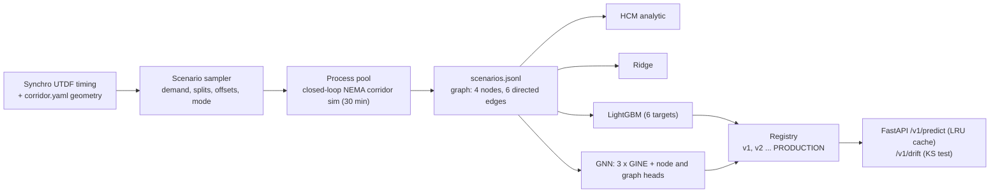
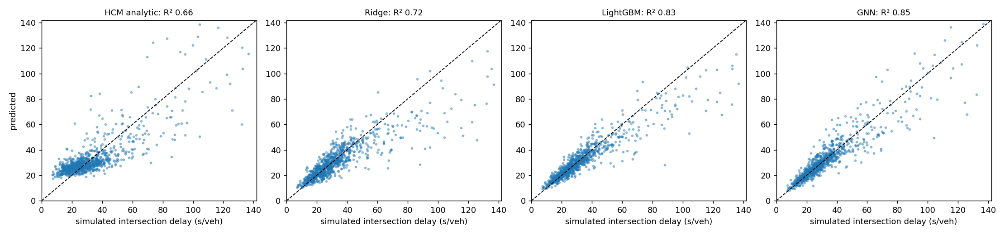

# traffic-gnn-surrogate-metamodel

**A graph neural network that stands in for a corridor traffic simulator.** 1,500 timing and demand
scenarios for a four-signal arterial are run through a closed-loop actuated-coordinated simulator
(the NEMA controller from [`synchro-vissim-ntcip-controller`](https://github.com/faysalchowdhoury/synchro-vissim-ntcip-controller),
vendored). Four models then learn to predict each intersection's delay and the corridor's fuel and
CO2 without running the simulator: an HCM analytic baseline, ridge regression, LightGBM, and a GNN
whose edges carry the offset relationship between neighbouring signals. The best model is promoted
in a file-based registry and served behind FastAPI with caching and a drift check.

**Headline (225 held-out scenarios):**

* **The GNN was the most accurate model:** mean intersection-delay R² **0.805** (MAE 4.8 s/veh),
  against 0.768 for LightGBM, 0.633 for ridge and **0.454 for the HCM equation**. Fuel R² 0.956.
* **It replaces a 1.46-s simulation with a 2.0-ms prediction** (p50, single scenario on CPU), about
  **730× faster**, and was also 4× faster than the six-booster LightGBM.
* **The drift check works as intended:** 0 of 52 input features flagged on held-out scenarios, 16 of 52
  flagged when the same scenarios carry 30% more demand.

---

## 1. Problem formulation

Signal-timing studies evaluate many alternatives: offsets, split shifts, actuated vs fixed, future-year
demand. Microsimulation gives credible answers but is slow, so screening hundreds of options is not
practical, and the HCM delay equation is fast but cannot see coordination between signals. A surrogate
trained on simulation output aims to be both fast and corridor-aware, **inside the range it was trained on**.

| Bar | Here |
|---|---|
| **Traffic engineering** | Four-signal arterial (Synchro UTDF timing), NEMA dual-ring actuated-coordinated control, per-intersection delay, Synchro/TRANSYT-style fuel and CO2, HCM 7 delay as the analytic baseline |
| **ML / MLOps** | GINE message passing with edge features, gradient boosting and linear baselines, train/validation/test split with early stopping, file-based model registry with PRODUCTION pointers, KS drift test with Bonferroni correction |
| **Systems** | Process-pool scenario generation, FastAPI inference with an LRU response cache, latency benchmark, CPU-only Docker image |

---

## 2. Architecture



---

## 3. Methodology

**Scenarios.** Each scenario perturbs the base corridor: a global demand factor U(0.6, 1.25), per-direction
arterial factors U(0.6, 1.3), per-intersection side-street U(0.5, 1.6) and left-turn U(0.5, 1.8) factors;
a split shift U(−8, +8) s moved between the coordinated and side-street phases (barrier sums stay equal);
random offsets; and fixed-time or actuated-coordinated control with equal probability. Each scenario is
simulated for 30 minutes after a 5-minute warm-up.

**Targets.** Volume-weighted stop-line delay at each intersection (node targets), and corridor fuel
$F = \text{VMT}\,k_1 + \text{delay}_{vh}\,k_2 + \text{stops}\,k_3$ with the Synchro/TRANSYT coefficients
at 40 mph, and CO2 at 8,887 g per gallon (graph targets).

**Graph.** Nodes are intersections with 10 features (approach volumes, arterial and side-street greens,
offset as sine and cosine, control mode, side-street lefts present). Directed edges link neighbours, with
the features that matter for progression: travel time over cycle length and the phase angle of
$(\text{offset}_b - \text{offset}_a - t_{travel})/C$ as sine and cosine.

**Models.** All learned models fit $\log(1+y)$ on standardised inputs.
* **GNN:** linear encoder, three residual GINE layers (hidden 64, LayerNorm) whose messages are
  conditioned on the edge features, a node head for delay and a mean+sum pooled graph head for fuel and
  CO2. AdamW, learning rate 3e-3, early stopping on the validation set (patience 40).
* **LightGBM:** one regressor per target (600 trees, learning rate 0.03) on the flattened node and edge features.
* **Ridge:** same features, α = 1.
* **HCM:** HCM 7 uniform plus incremental delay per lane group from the scenario's volumes and greens,
  with random arrivals (PF = 1). This is what a deterministic analysis would say without simulation.

Split: 1,050 train / 225 validation / 225 test scenarios, random.

---

## 4. Results ([`results/surrogate/RESULTS.md`](results/surrogate/RESULTS.md))



*Parity plots pool all four intersections, so their R² differs from the per-intersection mean below.*

### 4.1 Accuracy (225 test scenarios)

| Model | Mean intersection-delay MAE (s/veh) | Mean intersection R² | Fuel MAE (gal/h) | Fuel R² | CO2 R² | Fit time |
|---|---|---|---|---|---|---|
| HCM analytic | 8.41 | 0.454 | - | - | - | - |
| Ridge | 6.34 | 0.633 | 12.2 | 0.945 | 0.945 | 0.02 s |
| LightGBM | 4.86 | 0.768 | 13.7 | 0.930 | 0.929 | 6.7 s |
| **GNN** | **4.82** | **0.805** | **10.8** | **0.956** | **0.954** | 52 s |

Per intersection, the GNN's delay MAPE was 11-15%.

* **The HCM equation misses coordination.** It treats arrivals as random, so it cannot tell a good offset
  from a bad one. Its predictions bunch at 20-40 s/veh across a much wider range of simulated delay, and
scatter widely once intersections congest (first panel). This is the
  gap a corridor-aware model should close, and every learned model closes much of it.
* **The GNN's advantage is in delay, where neighbours interact.** At intersection 2 its R² was 0.82 vs 0.69
  for LightGBM. At intersection 4, at the end of the corridor, the two were level (0.76 vs 0.77).
* **For fuel, ridge beat LightGBM.** Corridor fuel is close to linear in volume (VMT dominates the fuel
  equation), and boosted trees approximate a linear trend with steps. Try the linear model first.
* **Errors grow with delay.** Above about 60 s/veh, where the training data is thin, the scatter widens for
  every model; ridge and LightGBM mostly under-predict there. The surrogate is a screening tool; final alternatives still need
  simulation.

### 4.2 Speed

| | p50 | p99 |
|---|---|---|
| Simulator (one 30-min scenario) | 1.46 s (mean) | - |
| GNN, all six targets | **2.0 ms** | 9.9 ms |
| LightGBM, six boosters | 8.6 ms | 17.6 ms |
| Ridge | 0.05 ms | 0.47 ms |

The GNN is about 730× faster than simulating, so 1,000 timing alternatives take about 2 seconds instead of
25 minutes. Because it was both more accurate and faster than LightGBM, the API serves the GNN by default
(`"model": "lightgbm"` is still available).

### 4.3 Drift

The registry stores the training feature table. `/v1/drift` runs a two-sample KS test per feature with a
Bonferroni correction. Held-out scenarios from the same distribution: **0 of 52** features flagged. The same
scenarios with demand scaled by 1.3: **16 of 52** flagged. Those are the 16 volume features (4 per intersection),
the only inputs a demand change touches, led by the eastbound arterial volumes (KS D = 0.34). That is the case where the surrogate is extrapolating and its answers should not be trusted.

---

## 5. Layout, reproduce, limitations

```
src/gnnsurrogate/data.py      scenario sampling, simulation runner, graph features, fuel/CO2
src/gnnsurrogate/models.py    CorridorGNN (GINE), scalers, training loop, HCM baseline
src/gnnsurrogate/train.py     fit all models, metrics, latency, drift demo, report, registry
src/gnnsurrogate/registry.py  versioned registry with PRODUCTION pointer, KS drift report
src/gnnsurrogate/api/app.py   /v1/predict (LRU cache), /v1/drift, /health ; cli.py
src/gnnsurrogate/sim/         vendored controller and corridor simulator (see VENDORED.md)
tests/ (8 tests: scenario feasibility, graph shapes, one simulation, GNN learns a toy function,
        HCM baseline, registry and drift, model shapes, API predict/cache/drift)
```

```bash
python -m venv .venv && .venv/Scripts/activate
pip install torch==2.5.1 --index-url https://download.pytorch.org/whl/cpu
pip install -r requirements.txt && pip install --no-deps -e .
gnnsurrogate generate -n 1500 --workers 2     # ~18 min on a 4-core laptop -> data/scenarios.jsonl
gnnsurrogate train                            # ~2 min -> results/surrogate/, registry/
pytest
docker build -f docker/Dockerfile -t gnnsurrogate . && docker run -p 8000:8000 gnnsurrogate
```

**Limitations.** One corridor geometry and a fixed 100-s cycle (the graph model could take other corridors,
but it was trained on one); the simulator is mesoscopic, not Vissim; 1,500 scenarios is small for the
congested tail; the HCM baseline uses PF = 1 by design; fuel uses the Synchro/TRANSYT-style equation rather
than an emissions model such as MOVES.

## License

MIT
