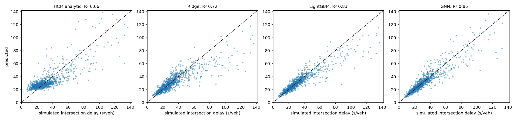

# Surrogate results

1500 simulated scenarios (train/val/test [1050, 225, 225]); simulation cost 1.46 s per scenario.

| Model | Mean node-delay MAE (s/veh) | Mean node R² | Fuel MAE (gal/h) | Fuel R² | CO2 R² | Fit time (s) |
|---|---|---|---|---|---|---|
| hcm | 8.41 | 0.454 | nan | nan | nan | nan |
| ridge | 6.34 | 0.633 | 12.19 | 0.945 | 0.945 | 0.0 |
| lightgbm | 4.86 | 0.768 | 13.72 | 0.930 | 0.929 | 6.7 |
| gnn | 4.82 | 0.805 | 10.79 | 0.956 | 0.954 | 51.6 |

## Single-scenario inference latency (in-process)

| Model | p50 (ms) | p99 (ms) |
|---|---|---|
| lightgbm_6_targets | 8.598 | 17.575 |
| gnn_all_targets | 1.999 | 9.906 |
| ridge | 0.048 | 0.469 |

## Drift check

Held-out scenarios vs training: 0/52 features flagged. Same scenarios with +30% demand: 16/52 flagged.

